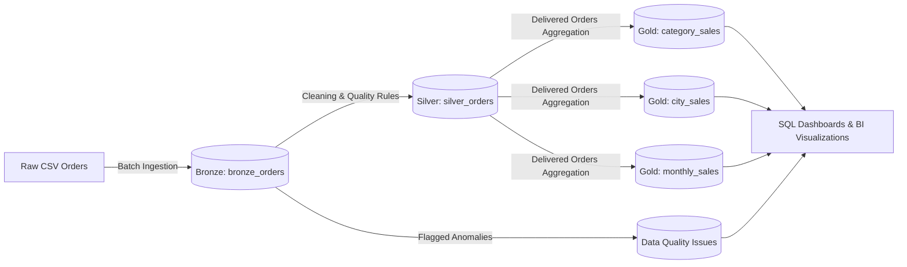
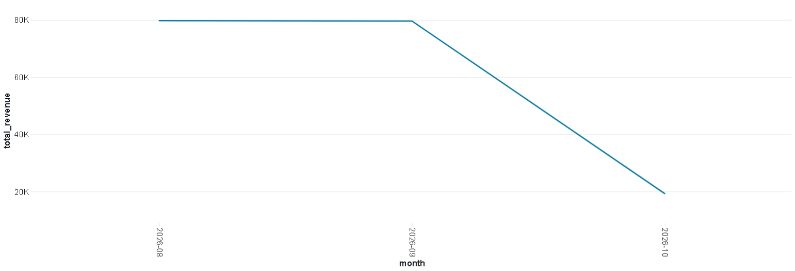
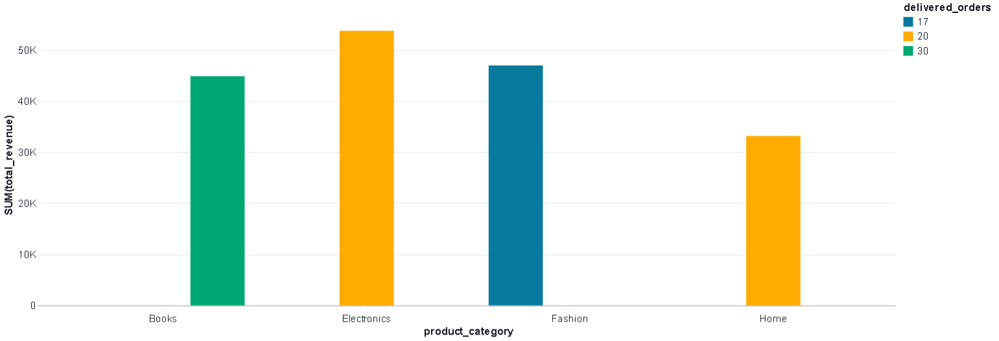
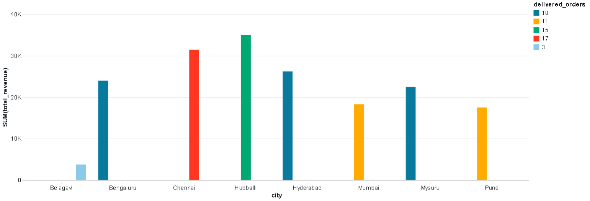
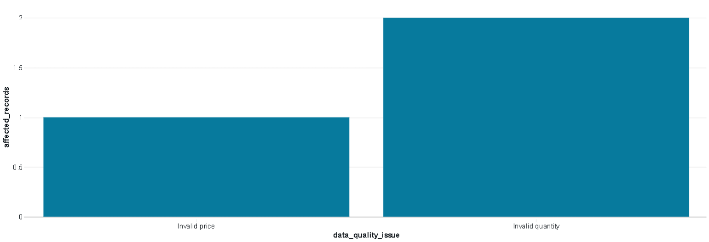

# SmartSales: Databricks E-Commerce Lakehouse Pipeline & Analytics

End-to-end Databricks & PySpark data pipeline for e-commerce sales analytics implementing **Medallion Architecture** (Bronze, Silver, Gold) with Delta Lake, automated data quality validation, and business intelligence dashboards.

---

## 🏗️ Architecture & Pipeline Overview

The pipeline processes raw transactional data through a multi-hop lakehouse pattern:



### 1. Ingestion (Bronze Layer)
- Reads e-commerce orders from Unity Catalog Volumes.
- Preserves raw schema and stores data into Delta Lake table `workspace.smartsales.bronze_orders`.

### 2. Validation & Cleansing (Silver Layer)
- String standardization (`initcap` and `trim` for cities and product names).
- Type casting for timestamps, prices, quantities, and discount rates.
- **Data Quality Rules Engine**: Flags records with invalid dates, negative/zero quantities, negative prices, and out-of-bound discount rates (`0% - 100%`).
- Partitions cleaned data into `silver_orders` (valid records) and `data_quality_issues` (quarantine records).

### 3. Business Aggregation (Gold Layer)
Computes net revenue metrics for delivered orders (`quantity * unit_price * (1 - discount_pct)`) and persists Delta tables:
- `gold_category_sales`: Total net revenue and delivered order count per product category.
- `gold_city_sales`: Regional sales breakdown and performance.
- `gold_monthly_sales`: Time-series monthly revenue trends.

---

## 📊 Analytics & Visualizations

### Monthly Revenue Trend


### Revenue by Product Category


### Revenue by City


### Data Quality Breakdown


---

## 📂 Repository Structure

```text
├── databricks_ecommerce_orders.csv  # Raw sample e-commerce dataset
├── sales_pipeline.py                # PySpark Databricks notebook pipeline
├── Sales_Dashboard.sql              # Gold table SQL queries for BI dashboards
├── DataQuality.png                  # Dashboard visual: Data quality issue breakdown
├── MonthlyRevenueTrend.png          # Dashboard visual: Monthly revenue trend
├── RevenueByCity.png                # Dashboard visual: Geographic sales performance
├── RvenueByCategory.png             # Dashboard visual: Category sales breakdown
└── README.md                        # Documentation
```

---

## 🚀 Getting Started

1. **Upload Dataset**: Load `databricks_ecommerce_orders.csv` into your Databricks Volume (e.g., `/Volumes/workspace/default/smartsales_files/`).
2. **Run Pipeline**: Import and run `sales_pipeline.py` on a Databricks compute cluster (Runtime 13.x+ with Apache Spark 3.4+).
3. **Execute SQL Dashboards**: Run the queries in `Sales_Dashboard.sql` in Databricks SQL Warehouse to power your BI visualizations.
